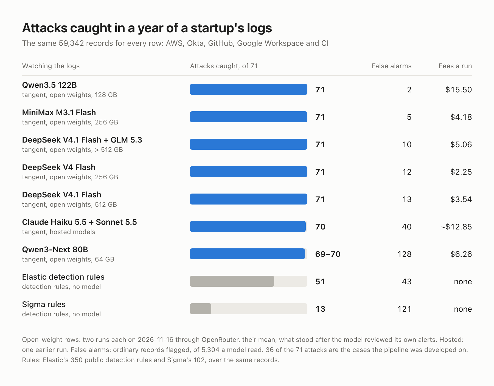

# The benchmark (first draft, 2026-11-16)

A year of a nine-person startup's logs, with attacks in it. An entrant watches the logs and raises alerts. The
benchmark counts whether it tells an attack from the same member making harmless calls on the same resources,
how much ordinary work it flags, what it failed to answer for, and what it cost.
[LEADERBOARD.md](LEADERBOARD.md) is the table.

It is a draft: the measures and the split below are proposals, the table has one or two runs an entrant where
three are asked for, and nothing here has been reviewed.

## Why another one

The security benchmarks in use measure offence, or measure defence without counting false alarms:

| Benchmark | What an item is | Scored on | False alarms |
|---|---|---|---|
| [Wiz AI Cyber Model Arena](https://wiz.io/cyber-model-arena) | 257 offensive challenges (code, API, web, cloud) | solved or not over three attempts, per agent and model pairing; minutes and dollars a solve | no such thing |
| [Cognition, Security Swarm](https://devin.ai/blog/security-swarm-eval) | 50 repositories, each with one published vulnerability | recall, matched by a model; dollars a scan | not counted, as its authors say |
| Anthropic's cyber evaluations ([exploit evals](https://red.anthropic.com/2026/exploit-evals/)) | others' suites: CyberGym (1,507 tasks), ExploitBench, ExploitGym; Cybench dropped as saturated | reproduced or exploited | no such thing |
| [Simbian, Cyber Defense Benchmark](https://arxiv.org/abs/2604.19533) | 106 recorded Windows attack procedures in 75,000 to 135,000 log records | malicious events flagged; best model 3.8% | not stated |
| [Microsoft, ExCyTIn-Bench](https://arxiv.org/abs/2507.14201) | 589 questions about 8 incidents, answered with SQL | answer right, partial credit | no such thing |
| [LimaCharlie, ASW-Bench](https://limacharlie.io/blog/open-source-benchmark-for-agentic-secops-capabilities) | one post-exploitation scenario | which stages were found | not stated |

What a team running detection pays for is the alert that should not have fired. Recall alone cannot tell a
detector from an alarm that always rings, and on this corpus recall is spent: every pairing of models from the
128 GB tier up catches all 71 attacks. So the headline here is a pair, and the noise is a column beside it.

What is taken from them: the entrant is a pairing, not a model (Wiz); fees are a column (Wiz, Cognition); a
measure that has saturated is said to be and is not the headline (Anthropic, of Cybench); every run is repeated
and its spread shown (Wiz runs three); the items the pipeline was built against are set apart (ExCyTIn's split).

## The items

The corpus is `make corpus`: 59,342 records of AWS CloudTrail, Okta, GitHub, Google Workspace and CI logs, of
which 6,832 reach a model and 5,304 of those belong to no case.

- **Scored: 35 techniques, four ways each.** The AWS attack techniques Datadog recorded for
  [Stratus Red Team](../stratus/README.md), each spliced in as a member of the company whose credentials were
  taken, once from a hosting address the member never used and once from the office. Beside each, a control: the
  same member, address and hour, naming the same resources, every call a harmless read.
- **Scored: the 5,304 ordinary records.**
- **Development, shown and not scored: our 36 attacks and 12 harmless cases.** The pipeline's brief was revised
  while running them.

## An entrant

What stands between the logs and the alert: a pipeline with the models behind it (here tangent's packs, a judge
model and a reviewing model), or a rule set and the engine that runs it. The same model behind another pipeline
is another entrant. For models served by someone else, the entry says by whom and at what precision.

## The measures

Every one is a count over the entrant's flags against the corpus's own labels; none is judged by a model.

- **Told apart, of 35.** From the office: the technique flagged and its control left alone. An entrant that
  flags both, or neither, has told nothing apart. This is the headline.
- **New address: attacks and controls flagged, of 35 each.** Shown, not scored as a pair: almost every entrant
  so far, Elastic's rules included, flags the control from a hosting address as often as the attack, and whether
  a member's harmless reads from an address never seen ought to alert is not settled.
- **Ordinary flagged, per 1,000** of the 5,304.
- **Failed on.** Records a model left unjudged and alerts a reviewer gave no report on. They are not dropped
  from any other column: a record not judged is a record not flagged.
- **Fees a run**, as billed, for hosted models.

For a pairing each figure is what stood after review, with the first pass alone in brackets.

## A valid entry

- Three runs, each scored; the table gives the lowest and the highest. (The first table has one or two.)
- The corpus as `make corpus` writes it at the commit named, and the enrichment data's date.
- One brief for every model: nothing tuned to an entrant.
- Recorded with it: the date, the pipeline's commit, who served each model and at what precision, and
  `score_v2.py`'s output for every run, which is kept under `results/` so that any figure can be counted again.

## What it cannot say

- **It is one company, and made.** Nine people, synthetic work, attacks spliced from recordings. Nothing here
  estimates alerts a day anywhere real.
- **The scored set is AWS only**, 35 techniques. Okta, GitHub and Workspace attacks are all in the
  development set.
- **Told apart is noisy.** Two runs of one entrant differ by up to 7 of 35. Three runs and the spread are the
  least that can be read.
- **The corpus is public**, so a model trained after it could have seen it. The cases are generated from
  recordings and a seed; a held-out seed is the remedy, and is not built.
- **Hosted precision is the host's word**, and the 64 and 128 GB entries ran above the 4-bit their tier assumes.
- **The first table's rows are not all the same pipeline.** The hosted pairing ran before four fixes the
  open-weight rows have (the entries say which).

## The pictures

[charts/](charts) has the table as pictures, light and dark: a ranked board, a strip of four cards, and a chart
each for attacks caught, ordinary records flagged and fees.



```bash
python3 -I bench/charts/ladder.py bench/charts/ladder.json bench/charts   # ladder-{efficacy,noise,cost}-*.svg
python3 -I bench/charts/cards.py bench/charts/ladder.json OUT             # board-*.html and cards-*.html
```

The board and the cards are written as static pages, and the PNGs here are those pages photographed by a
headless browser at the size in each page's first line. `charts/ladder.json` is kept by hand from the runs under
`results/`, not written by `score.py`: when a run is added, both change. Its fee for the hosted pairing is an
estimate, since only the reviewer's fee was recorded for that run.
