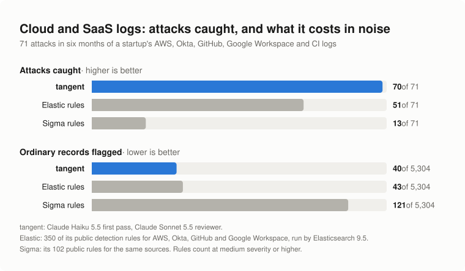
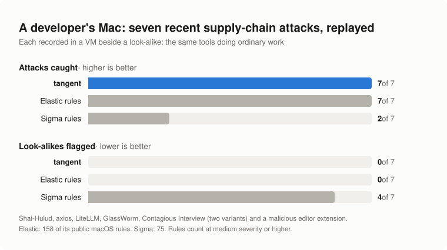

# tangent beside public detection rules

The same logs put to tangent and to the two public rule sets, Elastic's
[detection-rules](https://github.com/elastic/detection-rules) and
[Sigma](https://github.com/SigmaHQ/sigma)'s. Measured 2026-11-15, with
detection-rules at `836b566` and sigma at `54967d6`.





## Cloud and SaaS logs

The corpus `make corpus` writes: six months of acme's AWS, Okta, GitHub,
Google Workspace and CI logs, the 188 cases whose records the packs read,
198 judged windows. Every engine is scored by
[score_v2.py](../harness/score_v2.py) over the records tangent's judge was
shown, so the counts are of the same records.

| | tangent | Elastic's rules | Sigma's rules |
|---|---|---|---|
| attacks caught, of 71 | 70 | 51 | 13 |
| our cases, of 36 | 36 | 16 | 8 |
| Stratus techniques from an address never seen, of 35 | 34 | 35 | 5 |
| the same techniques from the member's usual place, of 35 | 28 | 26 | 5 |
| must-not-flag cases flagged, of 82 | 38 | 42 | 2 |
| ordinary records flagged, of 5,304 | 40 | 43 | 121 |

Each column's `score_v2.py` output is in [results/cloud](results/cloud),
with each rule's count beside it (`rules.json`).

- **tangent** is Claude Haiku 5.5 as the judge, then Claude Sonnet 5.5 as
  the second reviewer over what the judge flagged
  ([harness/review.py](../harness/review.py)). The judge alone
  (`tangent/judge.txt`): 70 of 71, 462 ordinary records flagged, 68 of the
  82 must-not-flag cases.
- **Elastic's rules** are those for AWS, Okta, GitHub and Google
  Workspace, run by Elasticsearch 9.5.6 itself
  ([cloud_es.py](cloud_es.py)): 350 ran, one failed (Google Workspace
  Object Copied from External Drive with App Consent), and 25 were not run:
  5 machine-learning rules, 4 that read other rules' alerts, 16 that read
  an index the corpus has nothing for. [cloud_elastic.py](cloud_elastic.py)
  is the same without Elasticsearch, by Elastic's `eql` package and a KQL
  reader of our own, and leaves the 79 ES|QL rules out: it gives the same
  51 of 71 (`elastic/`).
- **Sigma's rules** are the 104 for the same four sources; two use a
  modifier the reader here does not have and are skipped.
- A rule counts at medium severity or higher.

What to hold against these numbers:

- **The cases are ours.** 36 of the 71 attacks are cases we wrote, and the
  judge's brief was revised while running them. Eight of them are in CI job
  logs and runner egress, which no public rule reads. On Datadog's
  techniques Elastic's rules catch one more than tangent.
- **The mapping is ours.** Elastic's rules read ECS fields its ingest
  pipelines make. Here each provider's record is mapped to those fields by
  cloud_elastic.py, not by Elastic's pipelines. GitHub's audit log in the
  corpus has no user agent, and a stand-in is given.
- **Read in Elastic's favour where there was a choice.** An EQL rule's event
  category is read as `any`, and two rules' `stringContains` with a `*` is
  read as a wildcard.
- **The controls are undecided.** 34 of the 42 must-not-flag cases Elastic's
  rules flag, and 34 of tangent's 38, are a Stratus technique's harmless
  twin run from an address never seen: whether that should be flagged is not
  settled, and the charts leave the row out.
- **Three windows' reviews came back short.** 1,573 of 1,577 alerts were
  reviewed; the four that were not stand as flagged.

## A developer's Mac

The seven recorded attacks of [macos/](../macos) and their look-alikes, at
medium severity or higher.

| | tangent | Elastic's rules | Sigma's rules |
|---|---|---|---|
| attacks caught, of 7 | 7 | 7 | 2 |
| look-alikes flagged, of 7 | 0 | 0 | 4 |

- **tangent**'s numbers are [macos/results.json](../macos/results.json)'s.
- **Elastic's rules**: the 145 macOS rules written in EQL, run by Elastic's
  `eql` package ([elastic.py](elastic.py)), catch six. Thirteen rules in
  other languages are translated by hand in
  [elastic_more.py](elastic_more.py), and one of those is the only rule
  that catches GlassWorm; it reads file opens, which Elastic Defend records
  for chosen files only and the recording has for every file. The stand-in
  the attacks talk to is given a public address (`--public`), since many
  rules leave private addresses out. This side was not run in Elasticsearch.
- **Sigma's rules**: its 75 for macOS.
- The look-alikes were built to test tangent's judge, not rules: a look-alike
  made to trip a rule would be a different one.

## Run it

The rules are not kept here. Check out both repositories, at the commits
above for these numbers:

```bash
git clone https://github.com/SigmaHQ/sigma && git clone https://github.com/elastic/detection-rules
ruby compare/sigma_rules.rb macos sigma/rules/macos sigma/rules-emerging-threats sigma/rules-threat-hunting/macos > compare/sigma.json
ruby compare/sigma_rules.rb aws,okta,github,gcp sigma/rules/cloud/aws sigma/rules/identity/okta \
  sigma/rules/application/github sigma/rules/cloud/gcp/gworkspace > compare/sigma-cloud.json
```

Sigma's side is the standard library. Elastic's wants its `eql` package
(1.0.1 here) for the interpreter that runs it.

The cloud, after a judged run `RUN` of the corpus (`make`), whose
`verdicts.ndjson` says which records to score:

```bash
S=runs/stream
python3 -I compare/cloud_sigma.py $S/stream-packs-v3.ndjson RUN/verdicts.ndjson OUT/sigma
python3 -I compare/cloud_elastic.py detection-rules $S/stream-packs-v3.ndjson $S/truth-packs-v3.json RUN/verdicts.ndjson OUT/elastic
python3 -I compare/cloud_es.py detection-rules $S/stream-packs-v3.ndjson $S/truth-packs-v3.json runs/windows-packs-v3.json \
  RUN/verdicts.ndjson OUT/elasticsearch --es http://127.0.0.1:9200
python3 -I harness/score_v2.py $S/truth-packs-v3.json OUT/sigma     # and the others
```

`cloud_es.py` wants an Elasticsearch it can write to, with security off: it
makes an index template and data streams named as Elastic's integrations
name them, and deletes them first unless `--keep`. Use one of your own for
nothing else.

The Mac, with the recordings [macos/record.sh](../macos/record.sh) makes
(they are not in the repository):

```bash
python3 -I compare/sigma.py RECORDINGS > sigma.json
python3 -I compare/elastic.py detection-rules RECORDINGS --public > elastic.json
python3 -I compare/elastic_more.py detection-rules RECORDINGS --public > elastic-more.json
```

The charts: `python3 -I compare/chart.py compare/chart.json compare/charts`.
